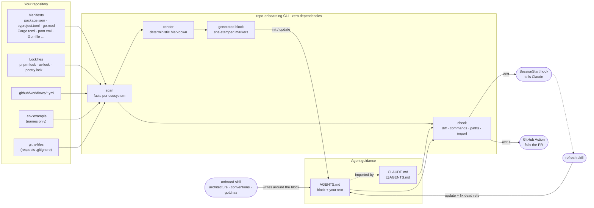

# repo-onboarding

**Onboarding docs for AI coding agents that stay true.** repo-onboarding writes the `AGENTS.md` and `CLAUDE.md` that tell Claude Code, Codex, Cursor and other agents how your repository works. The facts come from the repository itself, the judgment comes from your agent, and when the code moves on, it tells you.

English | [Türkçe](README.tr.md)

[](https://github.com/Tngc93/repo-onboarding/actions/workflows/ci.yml)
[](LICENSE)


<picture>
  <source media="(prefers-color-scheme: dark)" srcset="docs/assets/how-it-works-dark.svg">
  
</picture>

```text
$ npx github:Tngc93/repo-onboarding check
error The generated block in AGENTS.md no longer matches the repository. Run `repo-onboarding update`.
        - | Lint | `pnpm lint` | package.json |
        -   - `src/lib/` library code
        + | `check` | `pnpm check` | package.json |
        +   - `src/server/` server code
error 1 command in the docs no longer exists.
        AGENTS.md: `pnpm lint`: no "lint" script in package.json
warn  1 path mentioned in the docs could not be found.
        AGENTS.md: `src/lib/db.ts`
```

## Why

Agents read `AGENTS.md` or `CLAUDE.md` at the start of every session and trust it. A wrong line there costs more than a missing one: the agent runs a script that was renamed, edits a file that moved, or follows a convention the team dropped. These files are usually written once and then rot, because nothing checks them.

repo-onboarding splits the file in two:

- **A generated block** with what can be read from the repository: languages, package manager, commands, folder layout, environment variable names, CI checks. It is rewritten by `update` and compared with the repository by `check`.
- **Your text** around it: architecture, conventions, gotchas. The `onboard` skill drafts it by reading the code; you correct it. repo-onboarding never rewrites it, but `check` still verifies every command and path it mentions.

It also catches a quiet problem. When a repository has both files, Claude Code reads `CLAUDE.md` **instead of** `AGENTS.md`, so a team's `AGENTS.md` silently never reaches Claude unless `CLAUDE.md` imports it. Two of my own repositories had exactly this. `init` adds the one-line `@AGENTS.md` import; `check` reports it as an error.

## Quick start

Needs **Node.js 18.17+** and git. No install, no dependencies:

```bash
npx github:Tngc93/repo-onboarding init      # write AGENTS.md + CLAUDE.md
npx github:Tngc93/repo-onboarding check     # is it still true?
npx github:Tngc93/repo-onboarding update    # refresh the generated block
```

`init` leaves `TODO(onboarding)` placeholders where judgment is needed. Ask your agent to fill them: with the Claude Code plugin below, say *"onboard this repository"*; with any other agent, paste the steps from [`skills/onboard/SKILL.md`](skills/onboard/SKILL.md).

## Install

### Claude Code plugin

```text
/plugin marketplace add Tngc93/repo-onboarding
/plugin install repo-onboarding@repo-onboarding
```

You get two skills and one hook:

| | What it does |
| --- | --- |
| `onboard` skill | Runs `init`, reads the README, entry points, core modules, tests and CI, fills Architecture, Conventions, Before you finish and Gotchas, then runs `check` until it passes. Asks before moving text out of an existing `CLAUDE.md`. |
| `refresh` skill | Runs `update`, then tracks down what replaced each dead command or path (`git log -S`, manifests, search) and fixes the hand-written sections. |
| `SessionStart` hook | On startup, runs `check`. If the docs drifted, Claude is told once, briefly, and offers to refresh. Silent otherwise, and silent in repositories that never ran `init` unless `CLAUDE.md` is hiding `AGENTS.md`. Set `REPO_ONBOARDING_HOOK=off` to disable. |

### Codex

The repository ships `.codex-plugin/plugin.json` with the same two skills for Codex plugin marketplaces. You can also copy `skills/onboard` and `skills/refresh` into the folder your Codex version loads skills from. The CLI is the same for every agent.

### CI

Fail a pull request when the docs drift:

```yaml
# .github/workflows/agent-docs.yml
name: Agent docs
on: [pull_request]
jobs:
  check:
    runs-on: ubuntu-latest
    steps:
      - uses: actions/checkout@v4
      - uses: Tngc93/repo-onboarding@v0.1.0
        with:
          strict: "false"   # "true" also fails on placeholders, missing paths and docs over 200 lines
```

## How it works



What `check` reports:

| Code | Level | Meaning |
| --- | --- | --- |
| `missing` | error | No `AGENTS.md` (or the file passed with `--file`). |
| `stale` | error | The generated block differs from a fresh scan. The diff is printed. |
| `unknown-command` | error | A command written by hand (`npm run x`, `pnpm x`, `make x`, `just x`, `composer run x`, `deno task x`) no longer exists. Scripts in workspace packages count. |
| `claude-ignores-agents` | error | `CLAUDE.md` exists but does not import `AGENTS.md`, so Claude Code never reads it. |
| `broken-block` | error | A begin marker without an end marker. |
| `missing-path` | warn | A path written by hand (`src/lib/db.ts`) was not found. |
| `edited` | warn | Someone edited inside the generated block; `update` would overwrite it. |
| `placeholder` | warn | `TODO(onboarding)` placeholders remain. |
| `too-long` | warn | `AGENTS.md` and `CLAUDE.md` together exceed 200 lines, the size Anthropic recommends for files loaded every session. |
| `no-block` | warn | The file has no generated block, so only hand-written references are checked. |

`check` exits 1 on errors, 0 otherwise; `--strict` also fails on warnings, and `--json` prints machine-readable findings. To exempt one line from the command and path checks, add `<!-- repo-onboarding:ignore -->` to it.

## What the scanner reads

| Ecosystem | Detected from | Commands it documents |
| --- | --- | --- |
| Node.js | `package.json`, npm / pnpm / yarn / bun lockfiles, `packageManager`, `.nvmrc`, workspaces, `pnpm-workspace.yaml`, Turborepo, Nx | install and every script, in the right runner syntax |
| Python | `pyproject.toml`, `requirements*.txt`, uv, Poetry, PDM, Pipenv, Hatch, `.python-version` | install, pytest, Ruff, Black, mypy, Django `manage.py`, `[project.scripts]` |
| Go | `go.mod`, `go.work`, `.golangci.*` | build, test, vet, golangci-lint |
| Rust | `Cargo.toml`, workspaces, `rust-toolchain` | build, test, clippy, fmt |
| JVM | `pom.xml`, `build.gradle(.kts)`, wrappers | package / build, test |
| .NET | `*.sln`, `*.csproj`, `global.json` | build, test |
| Ruby | `Gemfile`, `.ruby-version` | bundle, Rails, RSpec, RuboCop |
| PHP | `composer.json` | install, composer scripts, PHPUnit |
| Deno | `deno.json` | tasks, test |
| Anything | `Makefile`, `justfile`, Docker Compose, GitHub Actions, `.env.example`, `LICENSE`, existing `CLAUDE.md` / `.cursorrules` / Copilot instructions | make targets, just recipes, `docker compose up`, the commands CI runs |

It reads files only. It never runs your build, installs packages or contacts the network, and from `.env.example` it keeps variable names, never values.

## Limitations

- The generated block covers what files can tell. Architecture and conventions still need an agent that reads the code, and a human who knows why.
- Path detection in hand-written text is heuristic: a path to something in *another* project, or one created at build time, can show up as `missing-path`. Use the ignore marker for those lines.
- Commands with leading flags (`pnpm --filter web dev`) are not verified, because the script name cannot be found reliably.
- One guidance file per run. For nested `AGENTS.md` files in a monorepo, run `check <package-folder>` once per package.

## Development

```bash
npm test                  # node:test, no dependencies
npm run check             # this repository's own AGENTS.md must stay current
npm run docs:update
```

This repository is onboarded with itself: see [AGENTS.md](AGENTS.md), and CI runs the action against it in strict mode.

## License

MIT © Berk Arcak
