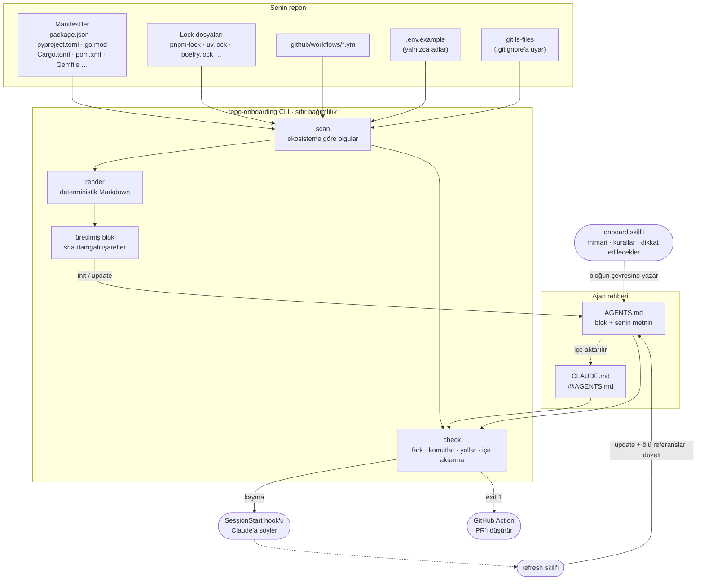

# repo-onboarding

**AI kodlama ajanları için doğru kalan onboarding dokümanları.** repo-onboarding, Claude Code, Codex, Cursor ve diğer ajanlara reponun nasıl çalıştığını anlatan `AGENTS.md` ve `CLAUDE.md` dosyalarını yazar. Olgular reponun kendisinden, yorum ajanından gelir; kod değiştiğinde de seni uyarır.

[English](README.md) | Türkçe

[](https://github.com/Tngc93/repo-onboarding/actions/workflows/ci.yml)
[](LICENSE)


<picture>
  <source media="(prefers-color-scheme: dark)" srcset="docs/assets/how-it-works-dark.svg">
  
</picture>

```text
$ npx github:Tngc93/repo-onboarding check
error The generated block in AGENTS.md no longer matches the repository. Run `repo-onboarding update`.
        - | Lint | `pnpm lint` | package.json |
        + | `check` | `pnpm check` | package.json |
error 1 command in the docs no longer exists.
        AGENTS.md: `pnpm lint`: no "lint" script in package.json
warn  1 path mentioned in the docs could not be found.
        AGENTS.md: `src/lib/db.ts`
```

## Neden

Ajanlar her oturumun başında `AGENTS.md` ya da `CLAUDE.md` dosyasını okur ve ona güvenir. Oradaki yanlış bir satır, eksik bir satırdan daha pahalıdır: ajan adı değişmiş bir script'i çalıştırır, taşınmış bir dosyayı düzenler ya da ekibin bıraktığı bir kurala uyar. Bu dosyalar genelde bir kez yazılır ve sonra çürür, çünkü onları kontrol eden bir şey yoktur.

repo-onboarding dosyayı ikiye böler:

- **Üretilmiş blok:** repodan okunabilen her şey. Diller, paket yöneticisi, komutlar, klasör yapısı, ortam değişkeni adları, CI kontrolleri. Bu bloğu `update` yeniden yazar, `check` repoyla karşılaştırır.
- **Senin metnin:** bloğun çevresindeki mimari, kurallar ve dikkat edilecekler. Taslağını `onboard` skill'i kodu okuyarak yazar, sen düzeltirsin. repo-onboarding bu metni asla yeniden yazmaz, ama içinde geçen her komutu ve yolu `check` yine doğrular.

Sessiz bir sorunu da yakalar. Bir repoda iki dosya birden varsa Claude Code `AGENTS.md` **yerine** `CLAUDE.md` okur. `CLAUDE.md` onu içe aktarmadıkça ekibin `AGENTS.md` dosyası Claude'a hiç ulaşmaz. Benim iki repomda da tam olarak bu vardı. `init` tek satırlık `@AGENTS.md` içe aktarmasını ekler, `check` ise bunu hata olarak bildirir.

## Hızlı başlangıç

**Node.js 18.17+** ve git yeterli. Kurulum ya da bağımlılık yok:

```bash
npx github:Tngc93/repo-onboarding init      # AGENTS.md + CLAUDE.md yaz
npx github:Tngc93/repo-onboarding check     # hâlâ doğru mu?
npx github:Tngc93/repo-onboarding update    # üretilmiş bloğu yenile
```

`init`, yorum gerektiren yerlere `TODO(onboarding)` yer tutucuları bırakır. Bunları ajanına doldurt: aşağıdaki Claude Code plugin'i kuruluysa *"onboard this repository"* demen yeterli. Başka bir ajanla çalışıyorsan [`skills/onboard/SKILL.md`](skills/onboard/SKILL.md) dosyasındaki adımları yapıştır.

## Kurulum

### Claude Code plugin'i

```text
/plugin marketplace add Tngc93/repo-onboarding
/plugin install repo-onboarding@repo-onboarding
```

İki skill ve bir hook gelir:

| | Ne yapar |
| --- | --- |
| `onboard` skill'i | `init` çalıştırır; README'yi, giriş noktalarını, ana modülleri, testleri ve CI'ı okur. Mimari, kurallar, bitirmeden önce yapılacaklar ve dikkat edilecekler bölümlerini doldurur, sonra `check` geçene kadar düzeltir. Mevcut bir `CLAUDE.md` dosyasından metin taşımadan önce sorar. |
| `refresh` skill'i | `update` çalıştırır, sonra her ölü komutun ya da yolun yerine neyin geldiğini bulur (`git log -S`, manifest'ler, arama) ve elle yazılmış bölümleri düzeltir. |
| `SessionStart` hook'u | Oturum açılışında `check` çalıştırır. Dokümanlar kaymışsa Claude'a bir kez, kısaca söylenir ve yenilemeyi önerir. Aksi halde sessizdir. `init` hiç çalıştırılmamış repolarda da sessizdir; tek istisna `CLAUDE.md` dosyasının `AGENTS.md`'yi gizlemesidir. Kapatmak için `REPO_ONBOARDING_HOOK=off`. |

### Codex

Repo, aynı iki skill'i Codex plugin marketplace'leri için `.codex-plugin/plugin.json` ile birlikte sunar. İstersen `skills/onboard` ve `skills/refresh` klasörlerini Codex sürümünün skill okuduğu klasöre de kopyalayabilirsin. CLI her ajan için aynıdır.

### CI

Dokümanlar kayınca pull request'i düşür:

```yaml
# .github/workflows/agent-docs.yml
name: Agent docs
on: [pull_request]
jobs:
  check:
    runs-on: ubuntu-latest
    steps:
      - uses: actions/checkout@v4
      - uses: Tngc93/repo-onboarding@v0.1.0
        with:
          strict: "false"   # "true": yer tutucu, eksik yol ve 200 satırı aşan doküman da hata sayılır
```

## Nasıl çalışır



`check` neleri bildirir:

| Kod | Seviye | Anlamı |
| --- | --- | --- |
| `missing` | error | `AGENTS.md` (ya da `--file` ile verilen dosya) yok. |
| `stale` | error | Üretilmiş blok, taze bir taramadan farklı. Fark yazdırılır. |
| `unknown-command` | error | Elle yazılmış bir komut (`npm run x`, `pnpm x`, `make x`, `just x`, `composer run x`, `deno task x`) artık yok. Workspace paketlerindeki script'ler de sayılır. |
| `claude-ignores-agents` | error | `CLAUDE.md` var ama `AGENTS.md`'yi içe aktarmıyor, bu yüzden Claude Code onu hiç okumuyor. |
| `broken-block` | error | Bitiş işareti olmayan bir başlangıç işareti. |
| `missing-path` | warn | Elle yazılmış bir yol (`src/lib/db.ts`) bulunamadı. |
| `edited` | warn | Üretilmiş bloğun içi elle düzenlenmiş; `update` bunun üzerine yazar. |
| `placeholder` | warn | `TODO(onboarding)` yer tutucuları duruyor. |
| `too-long` | warn | `AGENTS.md` ve `CLAUDE.md` birlikte 200 satırı aşıyor. Anthropic her oturumda yüklenen dosyalar için bu sınırı öneriyor. |
| `no-block` | warn | Dosyada üretilmiş blok yok, yalnızca elle yazılmış referanslar kontrol ediliyor. |

`check` hata varsa 1, yoksa 0 ile çıkar. `--strict` uyarıları da hata sayar, `--json` makinenin okuyabileceği çıktı verir. Bir satırı komut ve yol kontrolünden muaf tutmak için satıra `<!-- repo-onboarding:ignore -->` ekle.

## Tarayıcı neleri okur

| Ekosistem | Neyden anlar | Belgelediği komutlar |
| --- | --- | --- |
| Node.js | `package.json`, npm / pnpm / yarn / bun lock dosyaları, `packageManager`, `.nvmrc`, workspace'ler, `pnpm-workspace.yaml`, Turborepo, Nx | kurulum ve tüm script'ler, doğru runner sözdizimiyle |
| Python | `pyproject.toml`, `requirements*.txt`, uv, Poetry, PDM, Pipenv, Hatch, `.python-version` | kurulum, pytest, Ruff, Black, mypy, Django `manage.py`, `[project.scripts]` |
| Go | `go.mod`, `go.work`, `.golangci.*` | build, test, vet, golangci-lint |
| Rust | `Cargo.toml`, workspace'ler, `rust-toolchain` | build, test, clippy, fmt |
| JVM | `pom.xml`, `build.gradle(.kts)`, wrapper'lar | package / build, test |
| .NET | `*.sln`, `*.csproj`, `global.json` | build, test |
| Ruby | `Gemfile`, `.ruby-version` | bundle, Rails, RSpec, RuboCop |
| PHP | `composer.json` | kurulum, composer script'leri, PHPUnit |
| Deno | `deno.json` | task'ler, test |
| Hepsi | `Makefile`, `justfile`, Docker Compose, GitHub Actions, `.env.example`, `LICENSE`, mevcut `CLAUDE.md` / `.cursorrules` / Copilot talimatları | make hedefleri, just tarifleri, `docker compose up`, CI'ın çalıştırdığı komutlar |

Yalnızca dosya okur. Build'ini çalıştırmaz, paket kurmaz, ağa bağlanmaz. `.env.example` dosyasından yalnızca değişken adlarını alır, değerleri asla almaz.

## Sınırlar

- Üretilmiş blok, dosyaların söyleyebildiklerini kapsar. Mimari ve kurallar için hâlâ kodu okuyan bir ajana ve nedenini bilen bir insana ihtiyaç var.
- Elle yazılmış metindeki yol tespiti sezgiseldir. *Başka* bir projedeki bir yol ya da build sırasında oluşan bir dosya `missing-path` olarak görünebilir. Bu satırlar için muafiyet işaretini kullan.
- Başında bayrak olan komutlar (`pnpm --filter web dev`) doğrulanmaz, çünkü script adı güvenilir şekilde bulunamaz.
- Her çalıştırmada tek bir rehber dosyası. Monorepo'daki iç içe `AGENTS.md` dosyaları için her paket klasöründe `check <paket-klasörü>` çalıştır.

## Geliştirme

```bash
npm test                  # node:test, bağımlılık yok
npm run check             # bu reponun kendi AGENTS.md dosyası güncel kalmalı
npm run docs:update
```

Bu repo kendi aracıyla onboard edildi: [AGENTS.md](AGENTS.md) dosyasına bak. CI, action'ı bu repoya strict modda uygular.

## Lisans

MIT © Berk Arcak
